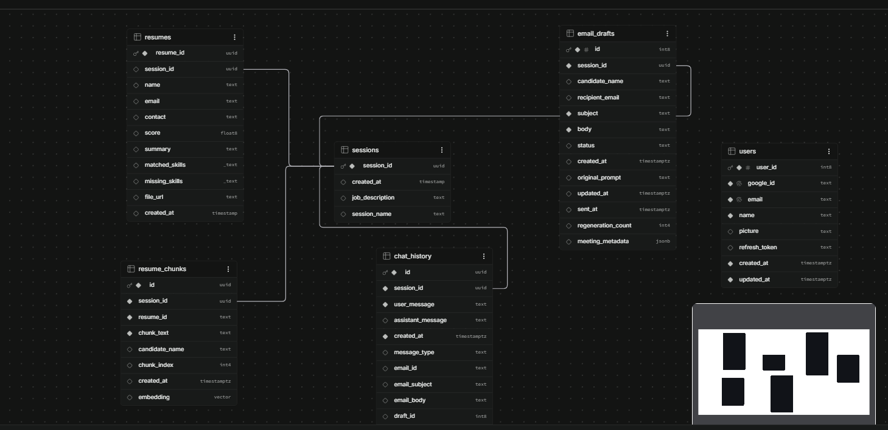

# Resume AI Assistant

An AI-powered recruitment assistant that helps recruiters **screen resumes, identify top candidates, interact with candidate data using natural language, and automate interview communication**.

The application combines resume analysis, Retrieval-Augmented Generation (RAG), AI-powered email drafting, Google Drive integration, and interview meeting creation into a single recruitment workflow.

---

## 🚀 Features

### 📄 AI Resume Screening

* Upload multiple candidate resumes in PDF format.
* Provide a Job Description (JD).
* Automatically extract and analyze resume content.
* Evaluate candidates against the Job Description using an LLM.
* Generate:

  * Candidate match score
  * Candidate summary
  * Matched skills
  * Missing skills
* Automatically shortlist and rank candidates.

---

### ☁️ Google Drive Resume Import

Recruiters can directly provide a **Google Drive folder link** containing candidate resumes.

The system:

1. Connects to Google Drive using OAuth.
2. Fetches resumes from the provided folder.
3. Extracts supported resume files.
4. Processes the resumes through the screening pipeline.

This eliminates the need to manually download and upload resumes.

---

### 🤖 AI Recruitment Chatbot

The application includes a RAG-based chatbot that allows recruiters to interact with candidate information using natural language.

Example queries:

* Who is the best candidate for this role?
* Find candidates with Python and FastAPI experience.
* Compare Shubham and Rahul.
* Which candidates are missing AWS experience?
* Show candidates with strong backend development skills.

The chatbot retrieves relevant resume chunks and generates context-aware responses.

---

### 🔍 Hybrid Resume Retrieval

The chatbot uses semantic resume retrieval to identify relevant candidate information.

Resume content is:

1. Extracted from uploaded resumes.
2. Split into smaller text chunks.
3. Converted into vector embeddings.
4. Stored in a PostgreSQL vector database.
5. Retrieved based on semantic similarity with recruiter queries.

This allows the assistant to answer questions using actual candidate resume data.

---

### ✉️ AI Email Assistant

Recruiters can generate candidate emails directly through the chatbot.

Example:

> Schedule an interview with Rahul for tomorrow at 5 PM.

The AI automatically:

* Identifies the candidate.
* Retrieves the candidate's email address.
* Generates an email subject.
* Drafts a professional email body.
* Extracts meeting details.
* Stores the email as a draft.

Recruiters can:

* Review the email.
* Modify meeting information.
* Regenerate the email.
* Send the email directly from the application.

---

### 📅 Interview Meeting Integration

The application supports automatic interview meeting creation.

When required, the system:

1. Extracts interview date and time.
2. Creates a meeting.
3. Generates the meeting link.
4. Adds meeting details to the email.
5. Sends the final email to the candidate.

---

### 💬 Chat History

Recruitment conversations are stored per screening session.

This allows recruiters to:

* Continue previous conversations.
* Maintain chatbot context.
* Review previous candidate queries.

---

### 🔐 Secure Cloud Storage

The application uses Supabase for:

* PostgreSQL database
* Resume metadata
* Resume chunks
* Vector embeddings
* Chat history
* Email drafts
* User data
* Private resume file storage

Resume files are stored inside a **private Supabase Storage bucket**.

---

## 🏗️ System Architecture

```text
                         ┌─────────────────────┐
                         │      Recruiter      │
                         └──────────┬──────────┘
                                    │
                                    ▼
                         ┌─────────────────────┐
                         │   Next.js Frontend  │
                         │   React + Tailwind  │
                         └──────────┬──────────┘
                                    │
                                    ▼
                         ┌─────────────────────┐
                         │   FastAPI Backend   │
                         └──────────┬──────────┘
                                    │
             ┌──────────────────────┼──────────────────────┐
             │                      │                      │
             ▼                      ▼                      ▼
    ┌─────────────────┐    ┌─────────────────┐    ┌─────────────────┐
    │ Resume Screening│    │  RAG Chatbot    │    │ Email Workflow  │
    │     Pipeline    │    │                 │    │                 │
    └────────┬────────┘    └────────┬────────┘    └────────┬────────┘
             │                      │                      │
             ▼                      ▼                      ▼
    ┌─────────────────┐    ┌─────────────────┐    ┌─────────────────┐
    │ LLM Evaluation  │    │ Vector Search   │    │ Email Generation│
    │                 │    │ + Retrieval     │    │ + Meeting Link  │
    └────────┬────────┘    └────────┬────────┘    └────────┬────────┘
             │                      │                      │
             └──────────────────────┼──────────────────────┘
                                    │
                                    ▼
                         ┌─────────────────────┐
                         │      Supabase       │
                         │                     │
                         │ PostgreSQL          │
                         │ Vector Embeddings   │
                         │ Private Storage     │
                         │ Chat History        │
                         └─────────────────────┘
```

---

## 🛠️ Tech Stack

### Frontend

* Next.js
* React
* TypeScript
* Tailwind CSS
* Axios
* Lucide React

### Backend

* FastAPI
* Python
* Pydantic

### AI and LLM

* Groq API
* Llama 3.1
* LangChain
* Sentence Transformers
* Retrieval-Augmented Generation (RAG)

### Embeddings and Retrieval

* Hugging Face Embeddings
* PostgreSQL Vector Search
* Supabase pgvector
* Text chunking and semantic retrieval

### Database and Storage

* Supabase
* PostgreSQL
* pgvector
* Supabase Storage

### External Integrations

* Google Drive API
* Google OAuth 2.0
* Zoom API
* Gmail SMTP

---


## 🗄️ Database Overview


## 🎯 Project Goal

The goal of Resume AI Assistant is to reduce repetitive recruitment work by combining **AI-powered resume screening, semantic candidate search, and recruitment workflow automation**.

Instead of manually reviewing hundreds of resumes and managing candidate communication across multiple tools, recruiters can perform these workflows from a single AI-powered interface.

---


